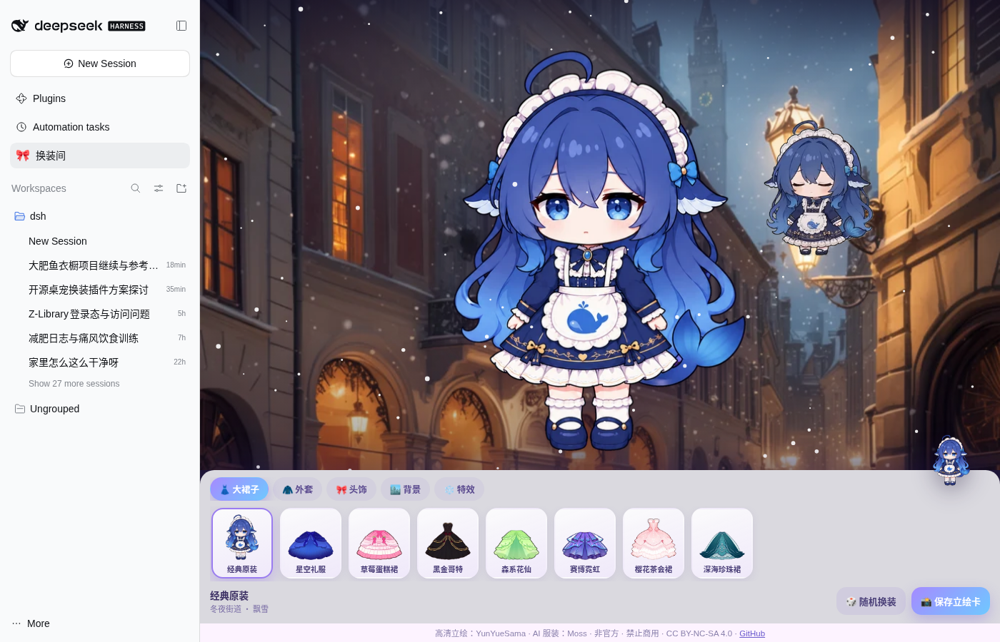
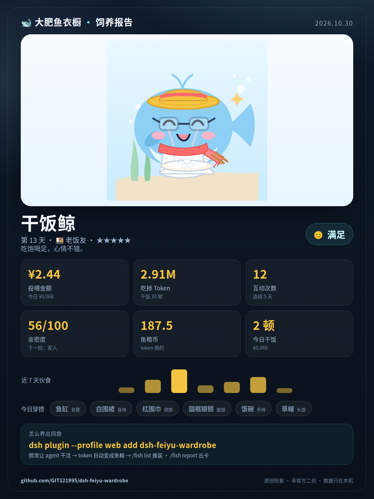
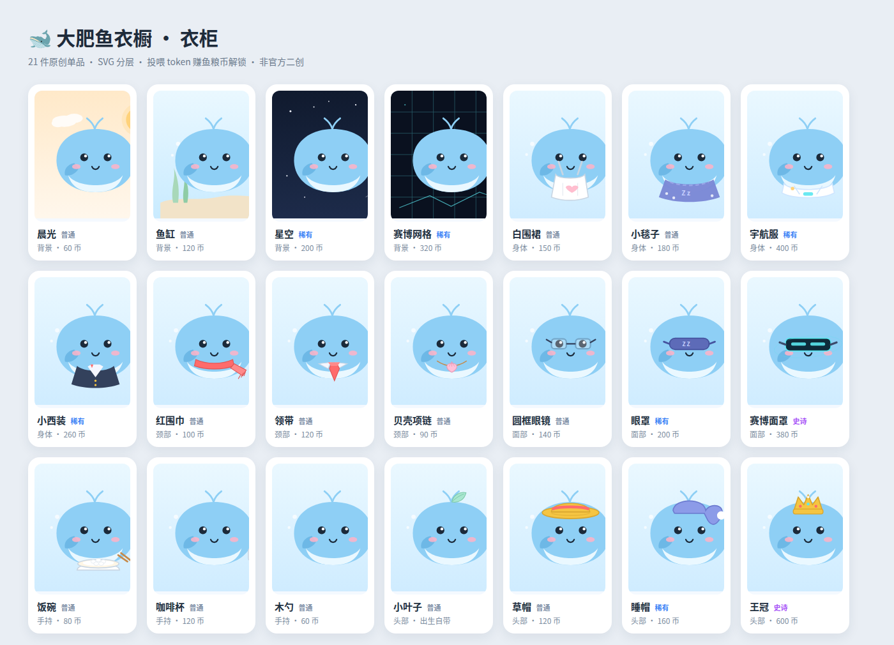
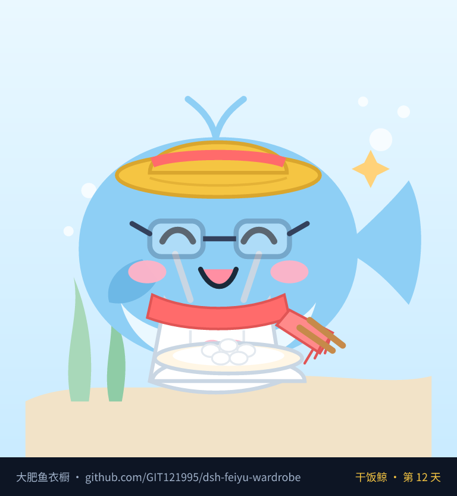
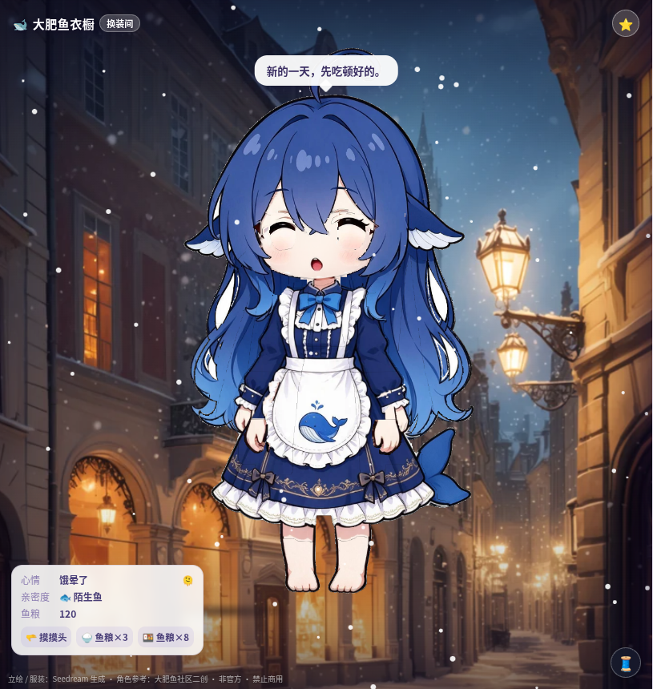

# 🐋 大肥鱼衣橱 · dsh-feiyu-wardrobe

[](https://www.npmjs.com/package/dsh-feiyu-wardrobe)
[](LICENSE)
[](https://github.com/deepseek-ai/deepseek-harness)

> 把 DSH 的 token 账单，变成一条鱼的衣柜。

当前版本：`3.2.1`（v3.2.1 **3.2.0 收尾补丁**：首屏解码并行化（base 页图集与 rig.bin 并行 fetch+decode，像素零变化）+ UV 定点精度 1e-5→1e-7（消除图集拆页后的亚像素重采样差异；资产 v26 / 页面 v29）。此前 v3.2.0 为 P1 性能第二步（lazy 5 页图集 + rig.bin 二进制 + brotli，首屏 chibi 0.96MiB/girl 0.80MiB），变更见 [CHANGELOG](CHANGELOG.md)）

**🆕 v2.0.0（2.5D-only，破坏性变更）**：装好插件后，DSH 侧边栏会出现 **🎀 换装间**，点开即玩——**左边舞台 + 右边衣柜**的经典换装布局；角色是**自研 WebGL2 2.5D 动态看板娘**（65 骨 / 15 弹簧链、LBS 蒙皮、头部跟随 / 歪头 / 点头、呼吸、发丝与裙摆物理、眨眼 / 笑眼 / 口型、双身形在线切换），**不再有 DOM 分层纸娃娃**（旧 DOM 渲染路径已按用户拍板删除）；**Q版 / 少女版双身形**，上衣 2（卫衣 / 水手服）× 下装 2（格纹 / 深蓝百褶）任意混搭 + 经典女仆长裙，另有 6 张场景背景、4 种粒子特效。养女儿向互动保留：摸摸头、喂食（消耗鱼粮）、心情、亲密度、每日问候、待机台词，与鱼粮经济联动。**需要浏览器支持 WebGL2**；不支持时换装间只显示文字提示（不做静态人物兜底），详见 `docs/dress-up/2.5D-RUNTIME.md`。**真机性能未测。**

**🆕 DIY 上传（0.11.0，可选 · 默认关闭）**：上传一张衣服照片 → 宿主本地代理调用云端图像 API 生成「角色穿这件衣服」的 look 与平涂色版 → 浏览器本地自动成层 → 预览确认后存入本地衣柜直接试穿；支持 `.dshskin` 导出/导入。默认关闭、需显式同意与费用确认、API key 只在宿主环境、内容守卫客户端+宿主双重拦截；详见下文「DIY 上传（可选 · 默认关闭）」。

**完全离线**：换装间和全部素材由插件自己的本地静态路由 `/feiyu/dress-up/` 提供，不依赖 GitHub Pages / 外部网络。

也可以免安装在线试玩：https://git121995.github.io/dsh-feiyu-wardrobe/dress-up/



DeepSeek Harness 插件：agent 每花掉一次 token，你的大肥鱼就**吃一顿饭**；一顿顿饭攒成**鱼粮币**，鱼粮币解锁 **21 件原创 SVG 穿搭**；`/fish report` 生成一张 **1080×1440 的饲养报告卡**，可以直接发小红书 / QQ 群。

- 🍚 **真实账本**：按 DeepSeek 官方峰谷价把每次模型调用折成人民币，再按 1 元 = 100 鱼粮币发币
- 🎨 **原创形象**：胖鲸 + 21 件手绘 SVG 单品（帽子 / 面部 / 颈部 / 身体 / 手持 / 背景），不打包任何画师二创素材
- 🎀 **换装小游戏（养女儿向、内容保守）**：侧边栏换装间 + **WebGL2 2.5D 动态角色**（Q版/少女版双身形 + 骨骼/物理/眨眼/口型 + 任意上衣×下装混搭 + 背景特效），全部离线（需浏览器支持 WebGL2）
- 🐋 **悬浮小鲸鱼**：可拖动的迷你立绘，实时跟随当前穿搭；左键互动、右键菜单打开换装间（不会误触跳转），面板里可一键隐藏
- 🔒 **纯本地**：换装间零额外模型调用、零外部网络请求，不存聊天原文，只存聚合数字
- 📸 **可晒卡**：饲养天数、投喂金额、吃掉 token、亲密度、心情、近 7 天伙食、今日穿搭
- 🖼️ **可视化出图**：`/fish png` 或 `dsh-feiyu-report --png` 直接渲染 PNG（默认 768，带 repo 水印），无需浏览器，可直接发 QQ 群 / B站评论区 / 小红书







> 名字与形象都是原创，属于社区玩梗项目，**不是 DeepSeek 官方产品**；「大肥鱼」一词来自社区对 DeepSeek 蓝色鲸鱼标识的可爱误认。

---

## 安装

需要 Node.js `>= 22.5` 和可用的 DeepSeek Harness（本版在 DSH `0.2.1-rc.2` 上实测）。

```sh
# 装进你正在用的 profile（web / tui / headless 按需替换）
dsh plugin --profile web add dsh-feiyu-wardrobe

# 重启后生效
dsh --profile web
```

重启后随便让 agent 干点活，然后：

```text
/fish
```

## 命令

| 命令 | 说明 |
| --- | --- |
| `/fish` | 看鱼今天的状态（投喂金额、token、亲密度、心情、穿搭） |
| `/fish list` | 逛衣柜：按部位列出全部单品、价格与拥有状态 |
| `/fish buy <名字\|id>` | 用鱼粮币买下并自动穿上 |
| `/fish wear <名字\|id>` | 换上已拥有的单品 |
| `/fish takeoff <部位>` | 脱掉某个部位（`bg` / `body` / `neck` / `face` / `hand` / `hat`） |
| `/fish rename <名字>` | 给鱼改名 |
| `/fish png [尺寸]` | 渲染当前穿搭的 PNG（默认 768；可直接发群） |
| `/fish report` | 生成饲养报告卡（HTML，1080×1440） |
| `/fish help` | 帮助 |

不占单独模型调用，命令本身不烧 token。

## 怎么玩

1. **喂食**：每次模型调用按官方峰谷价折成 CNY，`1 CNY = 100 鱼粮币`（可配置）。新鱼出生送 120 币 + 小叶子一顶。
2. **干饭 / 互动 / 连续天数** 一起涨 **亲密度**（0–100：陌生鱼 → 点头之交 → 饭搭子 → 老饭友 → 家人 → 过命交情）。
3. **心情** 由「今天吃了几顿 + 聊了几句 + 距上一顿多久 + 连续天数」决定：饿晕了 / 有点饿 / 悠哉 / 满足 / 撑到翻肚。表情会跟着变。
4. **衣柜** 21 件单品、三个稀有度：普通 / 稀有 / 史诗（王冠 600 币，慢慢攒）。
5. **晒卡**：`/fish report` 或 `dsh-feiyu-report` 生成竖版卡片，浏览器打开直接截图。

## 换装间（2.5D 动态角色）

`docs/dress-up/` 是一个纯前端换装页，也内嵌在 DSH 侧边栏面板里，免安装、手机也能玩：

- **左右布局**：左边舞台、右边衣柜（分类 + 纯衣服图标网格 + 随机/立绘卡）
- **单一渲染路径 = 自研 WebGL2 2.5D**：透明 canvas 上渲染骨骼蒙皮角色（65 骨 / 15 spring 链 / 两身形各 1 张图集），
  头部跟随鼠标、呼吸、发丝/裙摆物理、眨眼/笑眼/口型；背景与粒子特效仍在 CSS/DOM 层，换背景不触发 canvas 重绘
- **组合数 O(N)**：任意上衣 + 下装即时组合（卫衣/水手服 × 格纹/深蓝百褶），另有女仆连衣裙；
  所有服装共用同一骨架与物理，换装不重置头部/表情/物理状态
- **双身形切换**：Q版（三头身）/ 少女版（六头身），在线切换、参数/表情/物理状态保留
- **背景 6 + 粒子特效 4**（飘雪 / 花瓣 / 星光）任意搭配；默认穿搭 = 经典女仆装；互动台词走「养女儿/陪伴」路线，保守不含暗示
- 点角色说话（头部区域触发摸摸头）、随机换装、左右方向键换套装、**保存立绘卡**（900×1350）
- **无 WebGL2 时**：换装间只显示文字提示（「换装间需要 WebGL2；请升级浏览器或开启硬件加速」+ 重试按钮），
  不做静态图/人物兜底；**DIY 造型为静态贴片，不支持骨骼动画**
- **离线**：DSH 里由 `lib/webserver.js` 注册 `/feiyu/dress-up/` 静态路由（仅 GET/HEAD、拒绝目录穿越），不依赖 GitHub Pages



素材管线（全部可复现；详细说明见 [`tools/art/README.md`](tools/art/README.md)，运行时资产契约见 [`docs/dress-up/2.5D-RUNTIME.md`](docs/dress-up/2.5D-RUNTIME.md)）：

```sh
npm run fetch:sources    # 下载构建源素材（GitHub Release asset `assets-v3`）→ .cache/assets-src/，sha256 + 逐文件校验
npm run build:assets     # 确定性重建：源素材 → 拆件/绑定 → 图集打包 → tools/art/dist/{chibi,girl}/（约 5 分钟）
npm run verify:full      # 构建契约 + 与仓库内 docs/dress-up/art/2d5 逐字节比对
```

- 构建源素材约 150MB，**不入 git**（`.cache/` 已 gitignore），通过 GitHub Release 分发；`npm run fetch:sources -- --from <local.tar.zst>` 可离线导入。
- 构建需要系统 `tar`/`zstd` 与 `python3`（`pip install -r tools/requirements.txt`：pillow / numpy / opencv-python-headless；仅构建用，游戏运行零依赖）。
- 换资产时把 `tools/art/dist/{chibi,girl}/` 同步到 `docs/dress-up/art/2d5/` 并提升资产版本 `?v=`（见 [运行时说明](docs/dress-up/2.5D-RUNTIME.md)）；**不要手改产物**。
- 旧 DOM 分层素材管线（`build_wardrobe.py` / `build_masks.py`，v0.9 时代）已在 v2.0.0 删除，历史文档归档在 [`docs/archive/`](docs/archive/README.md)。

**素材版权**：

- 立绘 / 服装：本项目用 Seedream 5.0（火山方舟）基于自建素体生成，不是现有画作的再分发
- 角色概念参考：大肥鱼社区二创（上善无形「溟月」→ ZipZipPipe 女仆鲸鱼娘 的社区衍生形象），仅作风格与设定参考
- 本项目免费开源、**不商业化、不卖皮肤**

## DIY 上传（可选 · 默认关闭）

> **v2.1.0 · agent 可调用宿主管线（S2）+ 可动套装安装（S3）**：`dsh-feiyu-diy` CLI / `/diy` 命令把「图片 → Seedream look/flatout → 宿主 Python 自动成层 → 自动绑定 → QA → 安装」串成一条流水线（默认关闭、预算/守卫/缓存沿用本机 DIY 配置；失败自动回退静态贴片）。安装后的 DIY 套装会出现在换装间衣柜（🧵）：选中即**动态 2.5D 可动换装**（runtime 运行时合并增量 pack，不重建 base 图集），支持删除与 `.dshskin` 导出/导入；页面通过宿主 `/feiyu/diy/registry.json` 读取（静态托管/未开启 → 无 DIY，不报错）。格式见 [`docs/dress-up/DIY-PACK.md`](docs/dress-up/DIY-PACK.md)、管线见 [`docs/dress-up/DIY-PIPELINE.md`](docs/dress-up/DIY-PIPELINE.md)。

「✨ DIY 上传」把**你自己拍的衣服**变成角色能穿的分层图层：上传一张衣服照片（挂拍/平铺/穿着均可）
→ 宿主本地代理调用云端图像 API（火山方舟 Seedream）生成「角色穿这件衣服」的 look + 同姿势平涂色版
→ **浏览器本地 canvas** 自动 diff 成层（自适应阈值 / 补头发遮挡 / 拆袖 / 自动 QA）→ 预览确认后存入
浏览器 IndexedDB 本地衣柜，**以 2.5D 静态贴片方式试穿**（暂停骨骼动画、按槽位叠加全画布贴片）——UI 会明确提示「DIY 造型为静态，不支持骨骼动画」；可删除、可导出/导入本地 `.dshskin` 分享包。

**opt-in 与安全边界（很重要）**：

- **默认关闭**。不开启、不生成时没有任何网络请求，纯离线换装完全不受影响。
- 首次开启需要**显式同意**：衣服图会发送到云端图像 API 并产生费用（1 件 ≈ 2 张图 ≈ ¥0.42–0.60），
  每次生成前还会二次确认；宿主有**每日图片数/金额上限**，超限直接拒绝。
- **API key 只在宿主环境**（`ARK_API_KEY`，或 `~/.config/seedream/env`），不进前端、不进日志/错误响应；
  浏览器只与本机宿主同源路由通信，云端图片 URL 下载后即丢弃。
- **内容硬守卫**（客户端 + 宿主双重）：暴露/超短/性感向/涉未成年人输入直接拒绝，不送 API；
  偏短/贴身描述自动降级为保守版型（长袖/及膝/宽松）。基于文本词表 + 保守 prompt 模板，
  **图像分类器是后续项**（不宣称完全防护）。
- 生成结果与记录**只存在本机浏览器**（IndexedDB），不上传服务器、无遥测。

开启方式（宿主配置，改完重启 DSH）：

```yaml
- id: feiyu-wardrobe
  name: dsh-feiyu-wardrobe
  config:
    diy:
      enabled: true
      # dailyImageLimit: 40   # 每日张数上限
      # dailyBudgetYuan: 10   # 每日金额上限（¥）
```

完整契约见 [`docs/dress-up/DIY-PIPELINE.md`](docs/dress-up/DIY-PIPELINE.md)（宿主生成管线：代理路由/预算/守卫/QA/安装）
与 [`docs/dress-up/DIY-PACK.md`](docs/dress-up/DIY-PACK.md)（增量 pack 与 `.dshskin` 格式/runtime 消费）；
历史 M1 契约（浏览器本地成层/IndexedDB 本地衣柜）归档在 [`docs/archive/DIY-UPLOAD.md`](docs/archive/DIY-UPLOAD.md)。目前只支持 **Q版（chibi）** 身形。

## 报告卡 CLI

```sh
dsh-feiyu-report                    # 用本机 state 生成 HTML 卡片
dsh-feiyu-report --png fish.png     # 直接出 PNG（QQ 群 / 评论区可用）
dsh-feiyu-report --png fish.png --size 1024
dsh-feiyu-report --demo --png demo.png
dsh-feiyu-report --open             # 生成后用默认浏览器打开
dsh-feiyu-report --out card.html    # 自定义 HTML 输出路径
dsh-feiyu-report --sheet            # 渲染整个衣柜目录页
```

出图是纯本地 SVG → PNG（`@resvg/resvg-js`，预编译二进制），不调用浏览器、不联网。

## 配置

在 profile 的 `cordis.patch.yml` 里覆盖（都是可选项）：

```yaml
- id: feiyu-wardrobe
  name: dsh-feiyu-wardrobe
  config:
    fishName: 大肥鱼            # 初始鱼名，之后也能 /fish rename
    statePath: ""               # 默认 <DSH_HOME>/feiyu-wardrobe/state.json
    timezoneOffsetMinutes: 480  # 北京时间
    coinPerCNY: 100             # 1 元 token 花费 = 多少鱼粮币
    birthGiftCoins: 120         # 出生礼
    dailyRetentionDays: 120     # 每日台账保留天数
    holidays: []                # 法定节假日（峰谷价用），YYYY-MM-DD
    diy:                        # DIY 上传（可选，默认关闭；见 docs/dress-up/DIY-PIPELINE.md）
      enabled: false            # true = 开启云端生成 + 本地衣柜（需宿主 ARK_API_KEY）
      dailyImageLimit: 40       # 每日图片张数上限
      dailyBudgetYuan: 10       # 每日金额上限（¥）
    dressUp:                    # 换装间（v2：2.5D-only，无渲染模式开关）
      interaction:
        enabled: true           # 互动/喂食经济开关；false = 页面 local-only（只播台词/动作，不扣鱼粮）
```

## 隐私与版权

- **只存聚合数字**：金额、token 数、次数、日期、穿搭状态；不存任何聊天原文、模型输出、工具参数。
- **不联网**：插件和报告卡都不发请求；卡片是自包含 HTML，没有远程字体/图片/脚本。
- **两套美术**：报告卡里的胖鲸与 21 件单品是**本项目原创 SVG**；换装间的 2.5D 角色（65 骨绑定/图集）是**本项目用 Seedream 基于自建素体生成并自行绑定**的素材（角色概念参考社区二创），不直接再分发任何画作，不冒充官方形象。DIY 成层用的 3 张素体参考掩膜（`art/diy/masks/chibi/`）是不可见的算法输入，不是渲染资产。
- **非官方**：本项目是社区插件，不属于 DeepSeek 官方项目；「大肥鱼」相关梗的归属属于社区。
- 后续开放「皮肤包」格式时，同样只支持**本地加载**用户自己的素材，不代分发未授权作品。
- **DIY 上传默认关闭**：开启后仅把用户上传的衣服图 + 自建素体发给云端图像 API 用于生成；API key 只在宿主环境，生成结果/记录只存本机浏览器 IndexedDB，无遥测；可随时关闭开关或删除记录。

## 接 QQ / 聊天机器人（出图能力）

「换装」是视觉性的，所以核心能力是**出图**而不是出文字：

- 任何能执行命令的 QQ 机器人（LangBot、DSH + QQ 适配器等）都可以在 `wear` 之后调一次
  `dsh-feiyu-report --png /tmp/fish.png`，把 PNG 直接发到群里；
- DSH 内也可以用 `/fish png` 生成文件，再由机器人发送；
- 图片带仓库水印，别人转发一次就是一次曝光。

> 注意：本项目只负责「渲染并给出 PNG 文件」，QQ 平台的接入、账号风控由你选用的机器人框架负责。

## 兼容性与测试

- DSH `>= 0.1.0`（本版在 `0.2.1-rc.2` 实测）
- Node.js `>= 22.5`，零运行时依赖
- `npm run verify` = `tsc --checkJs` 类型检查 + **260+ 个**单元/集成测试（定价、经济、状态迁移、渲染、PNG、命令、CLI、换装间静态路由、2.5D 资产契约/图集完整性、manifest v8、无 WebGL2 纯文本提示、DIY 守卫/代理/预算/缓存/成层/IndexedDB 记录/`.dshskin`、M5 互动/经济、资产构建确定性）

```sh
npm run verify
```

## 质量门禁（1x / 2x 视觉）

- **1x 全身**：页面默认舞台尺寸（600–900px 高）下，角色无肉眼可见的接缝、双色块、白线；关节处允许 AA 过渡。
- **2x 关键局部**：膝 / 手 / 肩 / 脚 / 腹 / 发 / 颈等区域 2x 放大截图允许 ≤1px AA，不允许 ≥2px 连续白线/接缝/露底；领口露颈区域必须是真实素体颈部（无假脖子/肌腱亮条/重阴影，保留淡下巴影）；隐藏区 ±25° 转头/歪头不得露出背景洞。
- **视觉门禁**（v2.7.0 起随版本发布生效）：`npm run visual:qa -- --mode compare` 与 `docs/qa-baseline/` 基线做像素对比，超阈值即失败；`--mode baseline` 生成/更新基线。验收清单、baseline 更新流程与缺陷联动见 [`docs/VISUAL-QA.md`](docs/VISUAL-QA.md)。
- **已知缺陷**登记在 [`docs/QA-REGISTRY.md`](docs/QA-REGISTRY.md)（D-001 起，含 1x/2x 验收标准与回归方式）；视觉门禁通过 ≠ 已知缺陷已关闭。

## 路线图

- **已完成**：v0.7 真·分层换装 → v0.9 7 槽位纸娃娃 → v1.0.0 2.5D（opt-in）+ 养成互动
- **v2.0.0（破坏性变更）**：删除 DOM 分层渲染，收敛为 **2.5D-only**；无 WebGL2 仅文字提示；DIY 改静态贴片
- **v2.1.0 – v2.6.0**：DIY 全链路（agent 可调用宿主管线 + 可动增量 pack）、cutout 分件素体、脚部/双手精修、legBones（65 骨）、girl 后发全量拆件、**素体母版 v3（两件式露脐、接缝/双色统一，资产 v18 / 页面 v22）**
- **v2.6.1**：**高 DPI 2x 资产 hi tier**（DPR≥2 且设备达标自动启用 2x 素体/发/脸/尾 + 两页图集；弱机/DPR1 保持 1x；lo tier 像素零变化；资产 v19 / 页面 v23；量化：DPR2 脸/发/膝/手/腹 Laplacian 锐度 ×2.3–5.9、轮廓 IoU ≥0.997、显存 26→65MiB）
- **v2.6.2**：修复 chibi 素体隐藏区黑色残留（母版去发残留被写进 body-head/body-torso，发丝摆动/手臂动作时露出黑块；builder 增加隐藏区近黑保护 + 回归测试）
- **v2.7.0**：**下架白色高领毛衣**（高领不适配短脖子 chibi，用户拍板；上衣项 + `sweater-plaid`/`sweater-pleated` 两组合整体移除，production 组合降为 maid/hoodie-plaid/hoodie-pleated/sailor-plaid，rig drawables 69/70；旧存档 `top=sweater` 经 `normalizeState` 回退 `hoodie`，旧 v2.1 DIY pack 毛衣/裙子引用改映射 hoodie-plaid 部件；资产 v21 / 页面 v24）
- **v3.2.1**：**3.2.0 收尾补丁**——首屏解码并行化（base 页图集在 rig.bin 加载/网格上传期间并行 fetch+异步 decode；
  createImageBitmap 方案因预乘舍入产生亚阈值像素差异被否决，保持 HTMLImage 上传路径，像素零变化）
  + UV 定点精度 1e-5→1e-7（消除 v3.2.0 图集拆页引入的亚像素重采样差异 D-020；
  rig.bin 不变、rig.json 回退资产 +≈66KB；性能门禁 CI 因 GitHub token 缺 workflow scope 暂缓，待 3.2.2）；资产 v26 / 页面 v29
- **v3.2.0**：**P1 性能工程第二步**——lazy outfit page（方案 C：lo/hi 各 5 页图集 = base + 4 套装配图页，首屏只拉 base+当前套装，其余页首帧后空闲预取；零质量损失）+ rig 二进化（`rig.bin` 二进制 rig：header JSON + flat-f32 typed array 段，零拷贝解码 ≈0.7ms vs JSON.parse ≈25ms，JSON 回退兼容）+ brotli 静态传输（`.br` 预压缩优先/gzip 回退；rig 首屏 285KiB→133KiB）；首屏 transfer chibi **1.47→0.96MiB** / girl **→0.80MiB**，P1 ≤1MB 目标达成；资产 v25 / 页面 v28）
- **v3.1.1**：**P1 性能工程第一步**——图集打包 MaxRects-BSSF（利用率 92%、lo 显存 -36%、hi 显存 -15–17%、像素零回归；资产 v24 / 页面 v27）
- **v3.1.0**：**首屏加载体验 + 三缺陷修复**（自动 hi 设备 lo 先出首帧、hi 后台热切换；加载态提示/预加载/immutable 缓存/后台 prefetch；artfix 颈部 overlay 收窄到真实颈轮廓（girl 提亮+软化下颌线）与 8 套服装 16 层手心残留清除；源包 assets-v4；资产 v23 / 页面 v26）
- **v3.0.0**：**2.5D paper-doll 资产重做**（每套服装 2 个整层 drawable：top z=64 / skirt z=30、全画布单网格；rig drawables chibi 69→48 / girl 70→49；清除服装烘入假脖子、领口露真实素体颈；素体颈部一次性重绘 overlay（W8）lo/hi 双 tier 合成；旧存档/旧 DIY pack 旧分件→整层 id 映射；视觉门禁新增 neck 区域 80 张 baseline；资产 v22 / 页面 v25）
- **v3.2.x（收尾，规划）**：解码/上传 offload（createImageBitmap/Worker）、性能门禁进 CI（GitHub Actions）、可选 UV 精度 1e-7（消除 v3.2.0 图集拆分引入的子像素重采样差异）、真机抽测（D-008，需用户配合）；详见 HANDOFF §30（本机 `/home/ubuntu/dsh/FEIYU-HANDOFF.md`）
- **下一步 · 4.0.0（槽位底座，规划）**：通用槽位体系（上衣/下装/鞋/袜/头饰/耳饰/项链/手持）+ socket 骨骼锚定 + **lazy 页分组泛化** + 1–2 套验证穿搭（日常通勤 / 水手运动）+ 服装/配饰 2x 一并决策；执行计划 [docs/PLAN-4.0-SLOTS.md](docs/PLAN-4.0-SLOTS.md)；遗留 D-002/D-003/D-004/D-005/D-008/D-010/D-011/D-020 见 [QA 登记表](docs/QA-REGISTRY.md)
- **之后**：皮肤包社区交换码、DIY 图像分类器补强、**4.1 上传图批量生成穿搭**（依赖 4.0 稳定）
- 更远：多鱼塘（多会话鱼）、每日小任务；把 `dsh-memory-gate` 的记忆做成「鱼记得你说过什么」，但依然只读聚合摘要

## 开发

```sh
git clone https://github.com/GIT121995/dsh-feiyu-wardrobe && cd dsh-feiyu-wardrobe
npm install
npm test            # node --test
npm run typecheck   # tsc --checkJs
node bin/feiyu-report.mjs --demo --out card.html   # 预览报告卡
```

结构：

```text
lib/webserver.js 换装间本地静态路由（/feiyu/dress-up/，离线可用）
lib/client.js    浏览器半区：侧边栏换装间入口 + 主面板 iframe + 悬浮小鲸鱼
docs/dress-up/   换装间前端：2.5D-only（runtime-2d5*.js + manifest v8 + art/2d5/<shape>/{rig.bin,rig.json,atlas*.webp 5 页懒加载图集}）
tools/art/       资产构建管线（build_prod.py 拆件/绑定 → build_2d5.py 图集；源素材打包/获取脚本，见 tools/art/README.md）
docs/            运行时文档、视觉门禁（VISUAL-QA.md）、缺陷登记表（QA-REGISTRY.md）、历史文档归档（archive/）
lib/catalog.js   21 件原创 SVG 单品 + 稀有度/价格
lib/render.js    360×360 场景与 1080×1440 报告卡
lib/economy.js   鱼粮币 / 亲密度 / 心情 / 连续天数
lib/pricing.js   DeepSeek 官方峰谷价计费
lib/runtime.js   会话事件 → 经济系统，买/穿/改名
lib/commands.js  /fish 命令
bin/             dsh-feiyu-report CLI
```

## License

MIT。见 [LICENSE](LICENSE)。
